# Fresh Shelf: UI review

Screenshots of the `fresh-shelf` branch on the demo data (as of 31 Dec 2025), taken with Playwright at
desktop (1440 px) and phone (390 px) width in light and dark mode. Full checks: `scripts/crawl_pages.py`
opened every page with every source in both modes and widths (92 checks, 0 exceptions or console errors).

## Overview

| | Light | Dark |
| --- | --- | --- |
| Desktop | 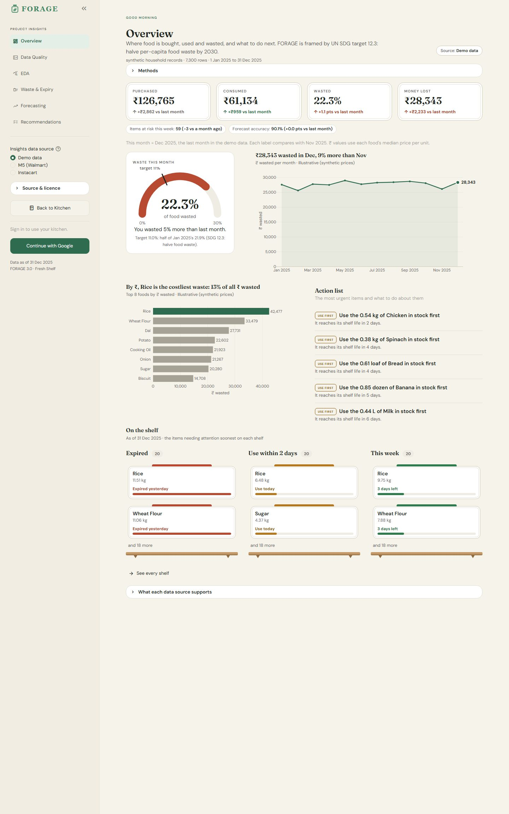 | 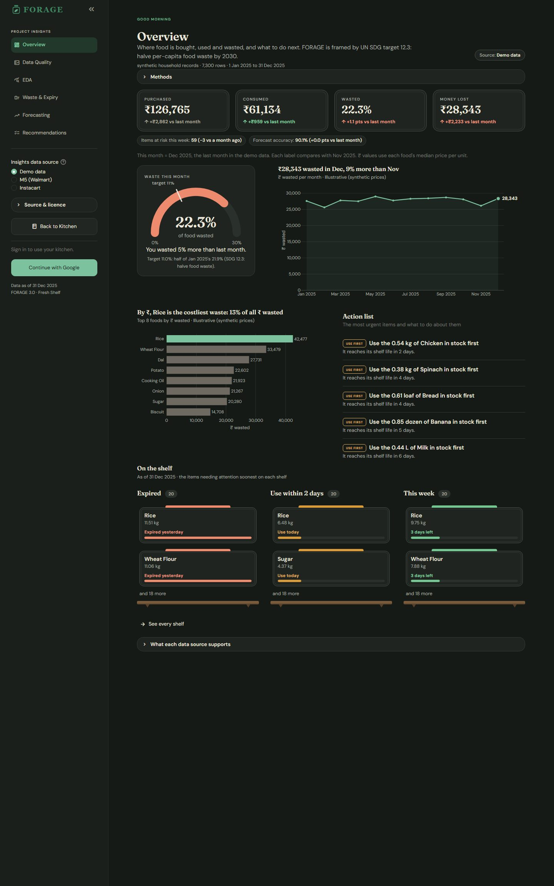 |
| Phone | 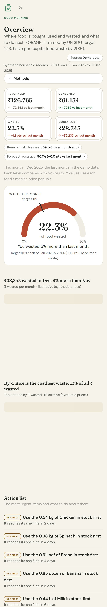 | 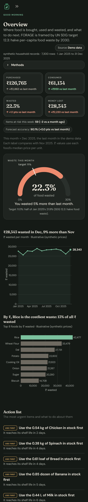 |

## Expiry (Waste & Expiry → Expiry tab)

| | Light | Dark |
| --- | --- | --- |
| Desktop | 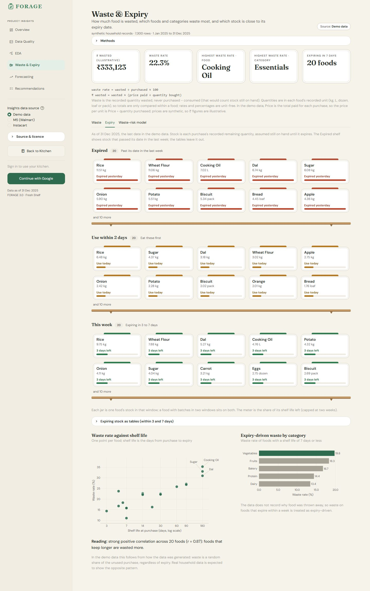 | 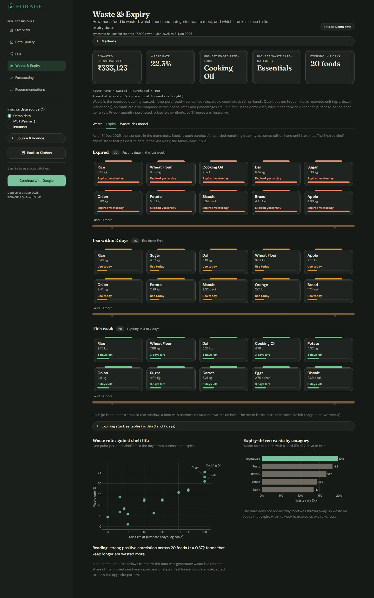 |
| Phone | 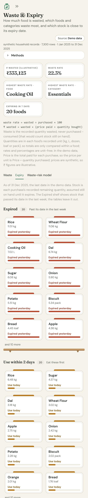 | 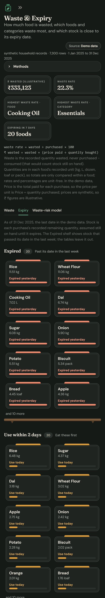 |

## Predictions (Forecasting)

| | Light | Dark |
| --- | --- | --- |
| Desktop | 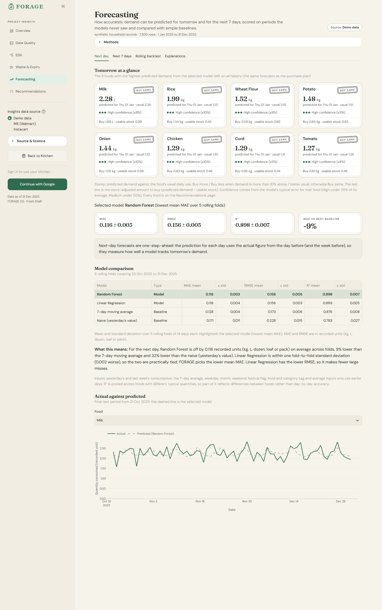 | 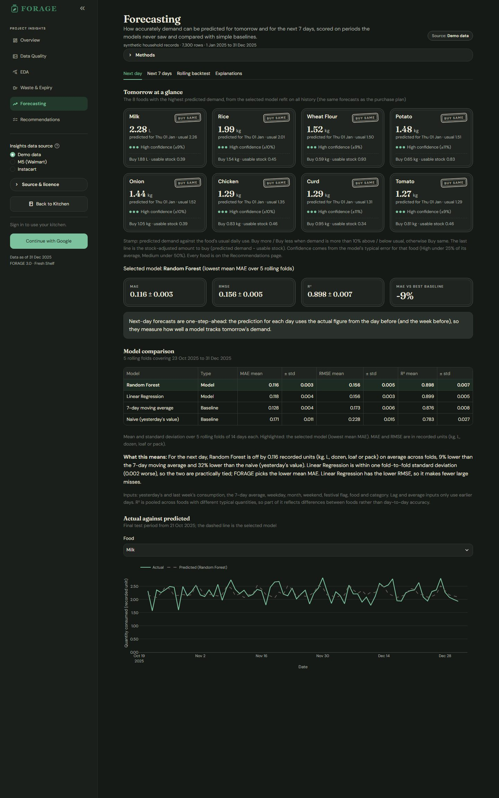 |
| Phone | 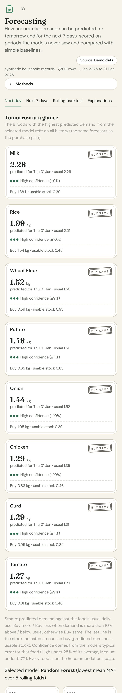 | 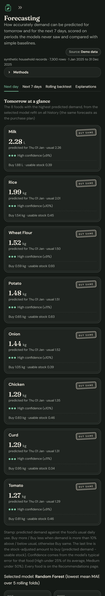 |

## Recommendations

| | Light | Dark |
| --- | --- | --- |
| Desktop | 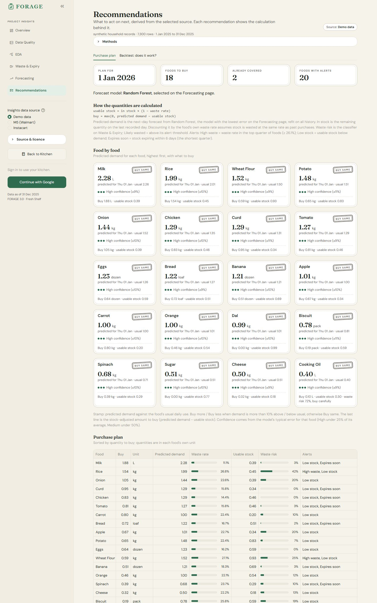 | 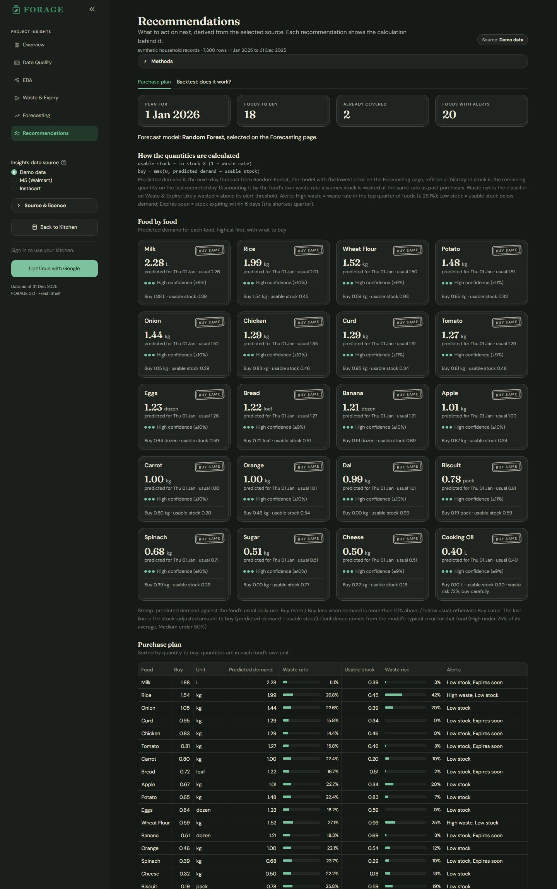 |
| Phone | 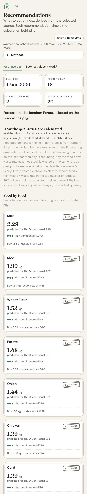 | 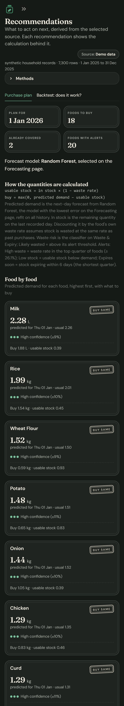 |
